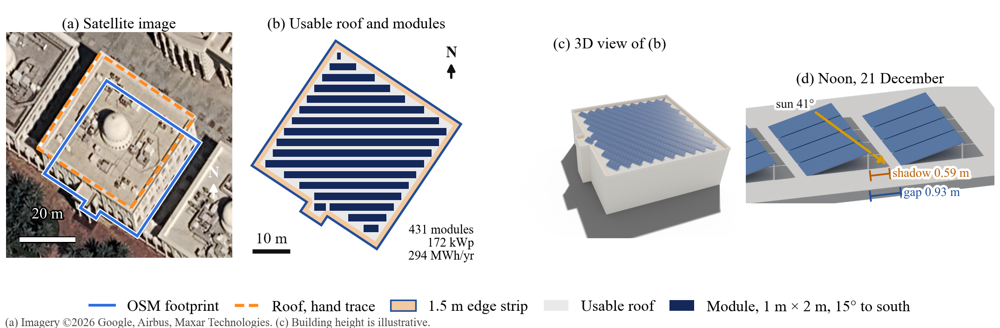
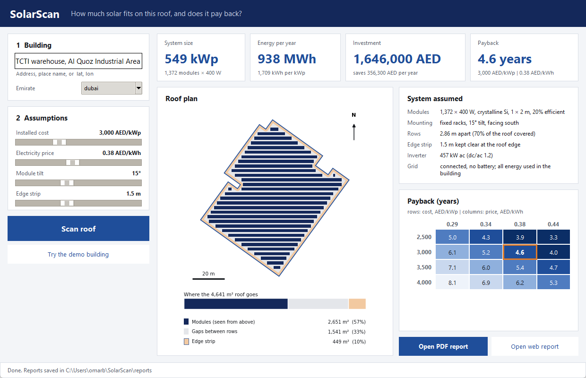
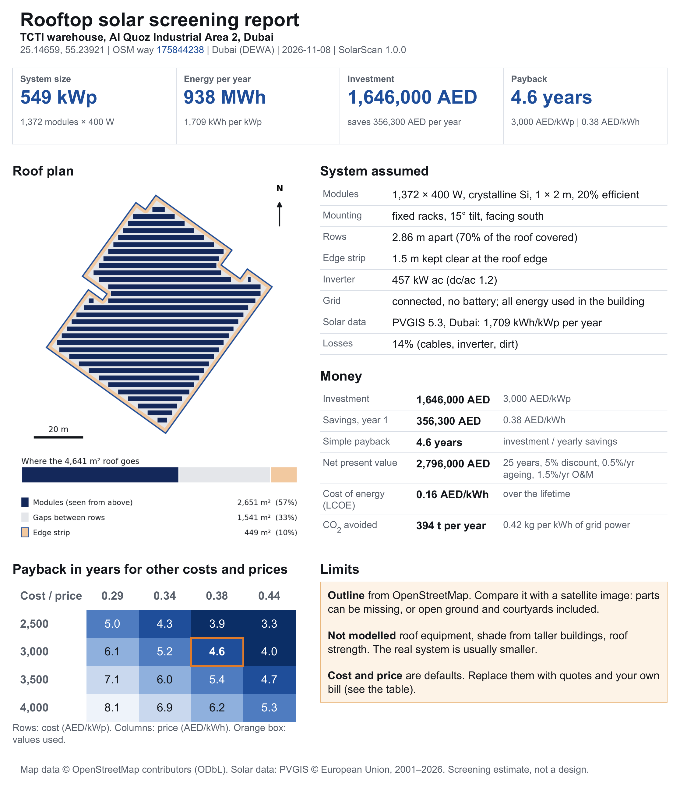
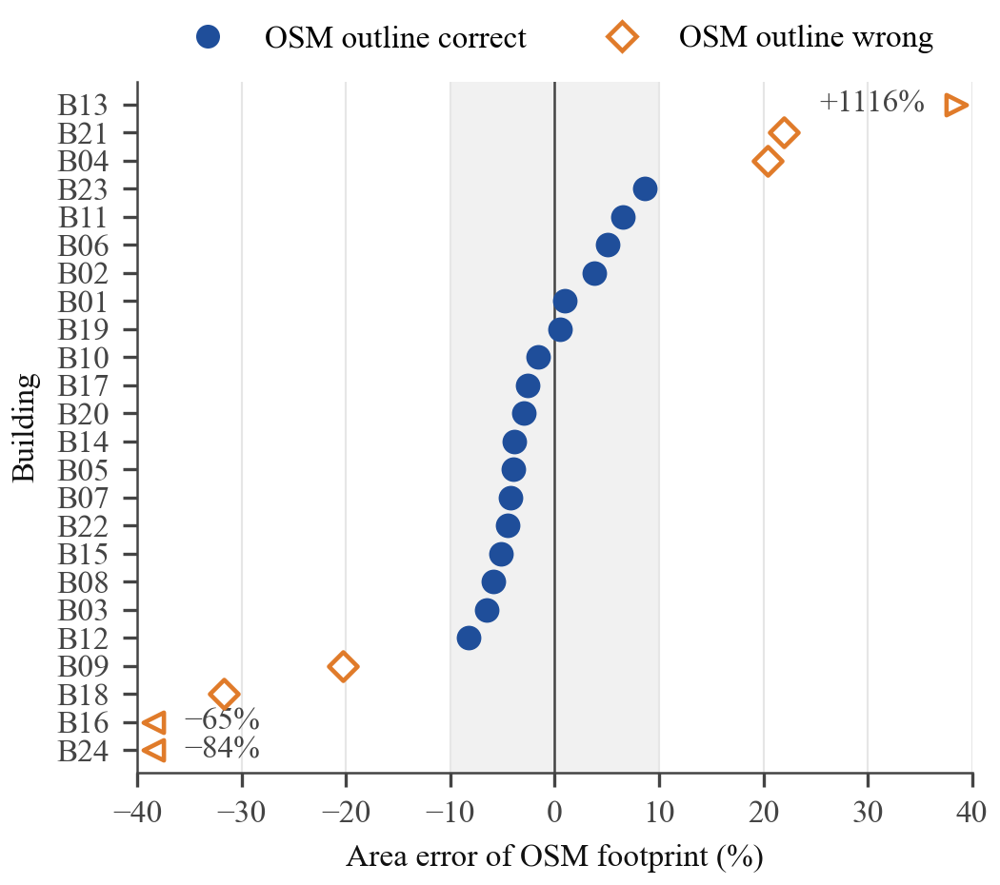
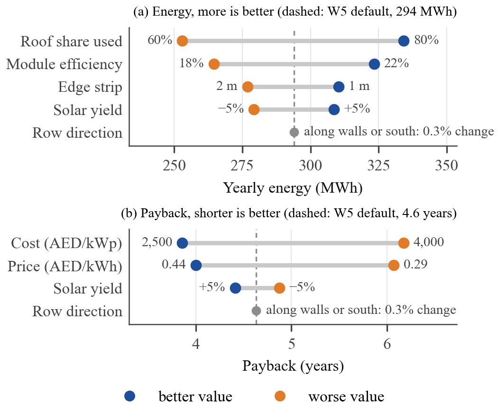
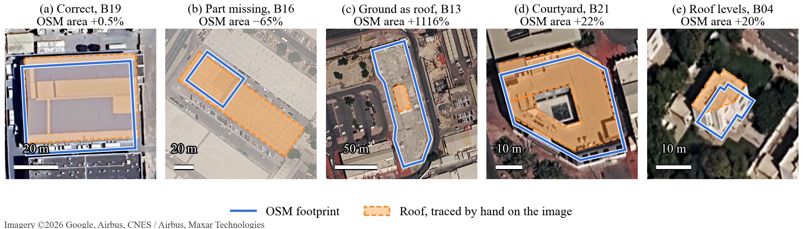

<h1 align="center">SolarScan</h1>
<p align="center"><b>How much solar fits on this roof, and does it pay back?</b><br>
An address in, a one-page answer out. Free data only: OpenStreetMap + PVGIS.</p>

<p align="center">
<a href="https://github.com/IamOumarIbrahim/rooftop-scanning/raw/main/manuscript/main.pdf"></a>
</p>

<p align="center">


<a href="LICENSE"></a>
</p>



## How it works

```mermaid
flowchart LR
    A([Address or<br>coordinates]):::in --> B[OSM building<br>outline]:::osm
    B --> C[Usable roof<br>minus 1.5 m edge]:::geo
    C --> D[Module rows<br>that fit]:::geo
    D --> E[Energy per year<br>PVGIS]:::sun
    E --> F[Payback, NPV,<br>LCOE, CO₂]:::money
    F --> G([One-page<br>report]):::out
    classDef in fill:#eef3fa,stroke:#1f4e9a,color:#14171c
    classDef osm fill:#dbe5f4,stroke:#1f4e9a,color:#14171c
    classDef geo fill:#f2c9a0,stroke:#c0752a,color:#14171c
    classDef sun fill:#ffe8a3,stroke:#d4a017,color:#14171c
    classDef money fill:#d7ecd9,stroke:#2e7d32,color:#14171c
    classDef out fill:#14285a,stroke:#14285a,color:#ffffff
```



## The tool

<table>
<tr>
<td width="62%"></td>
<td width="38%"></td>
</tr>
<tr>
<td><b>Desktop interface</b>: double-click <code>SolarScan.bat</code> (or run <code>solarscan gui</code>).
Type an address, press <i>Scan roof</i>. Cost and price sliders update the payback at once.</td>
<td><b>One-page report</b> (PDF + HTML). Key numbers, roof plan, system assumed, money, payback table, limits.
Shown: the demo building, a warehouse in Dubai.</td>
</tr>
</table>

## Results at a glance

All numbers come from `python scripts/reproduce.py`; none are typed by hand.

| Question | Answer |
|---|---|
| Is the OSM roof area right? | When the outline matches the building (**17 of 24**): mean error **4.4 %**, all within ±9 % |
| How does it fail? | **7 of 24** outlines wrong: part missing (4), open ground as roof, courtyard as roof, several roof levels |
| How many modules really fit? | Real rows fit a median **92 %** of the simple *area × 0.70* rule (64 to 99 %) |
| Is the yield right? | PVGIS and pvlib agree within **1.8 %** |
| What does one building give? | University building W5: **431 modules, 172 kWp, 294 MWh/yr, payback 4.6 years** |
| What changes the answer most? | Cost and electricity price (payback 3.9 to 6.2 years), not roof shape or panel direction |

<table>
<tr>
<td width="50%"></td>
<td width="50%"></td>
</tr>
<tr>
<td><b>OSM area error per building.</b> Blue: outline correct. Orange: outline wrong.</td>
<td><b>What changes the answer.</b> Each line: one input moved between two values.</td>
</tr>
</table>



## Install and run

**Windows, no typing:** double-click `SolarScan.bat`. The first start installs everything (needs Python 3.10+).

```bash
git clone https://github.com/IamOumarIbrahim/rooftop-scanning.git
cd rooftop-scanning
pip install -e ".[dev]"

solarscan gui                                                           # desktop interface
solarscan demo --format both                                            # offline demo (warehouse, Dubai)
solarscan scan "Computer Science Department W5 Sharjah" --format both   # live OSM lookup
solarscan scan "Warehouse" --lat 24.9754 --lon 55.0768 --emirate dubai  # by coordinates
solarscan batch my_buildings.csv --out reports/batch                    # many buildings
```

## System assumed

| | Default | Change with |
|---|---|---|
| Modules | 400 W, 1 m × 2 m, crystalline Si, 20 % | `module_efficiency` |
| Mounting | fixed racks, 15° tilt, facing south | `--tilt`, `array_layout` |
| Rows | 2.86 m apart (70 % of roof covered) | `packing_factor` |
| Edge strip | 1.5 m | `--setback` |
| Inverter | dc/ac ratio 1.2 | `dc_ac_ratio` |
| Grid | connected, no battery, all energy used in the building | – |
| Solar data | PVGIS 5.3 (SARAH-3), 14 % losses | – |
| Money | 3,000 AED/kWp, 0.38 AED/kWh, 5 % discount, 25 years | `--cost`, `--rate-aed` |

All defaults live in [`solarscan.yaml`](solarscan.yaml); their sources are in [`solarscan/config.py`](solarscan/config.py).

## Reproduce the paper

```bash
python scripts/reproduce.py            # numbers, tables, figures, tests, PDF (offline)
python scripts/reproduce.py --verify   # same, and fail if any committed result changes
python scripts/reproduce.py --online   # refresh PVGIS, footprints, imagery, pvlib, DOIs first
python experiments/screenshots.py      # interface and report pictures (needs a display)
```

## Repository map

| Path | Contents |
|---|---|
| `solarscan/` | The tool: geometry, layout, PVGIS yield, economics, OSM client, report, CLI, GUI |
| `data/` | 24 benchmark buildings, OSM snapshots, hand traces ([how to add one](data/reference_traces/README.md)), Microsoft footprints |
| `experiments/` | `analysis.py` (all numbers), `figures.py`, Blender render, download and screenshot scripts |
| `results/` | Generated results (`results.json`, `validation_dataset.csv`) |
| `manuscript/` | IEEE paper; `generated/` holds the numbers and tables from `analysis.py` |
| `scripts/` | `reproduce.py`, manuscript and reference checks |
| `tests/` | `pytest` suite |

## Limits

A screening tool, not a design. It uses the building outline, not the roof itself, and does not see
roof equipment, shade from taller buildings or roof strength. Check the outline on a satellite image,
and enter your own cost and electricity price.

## Citation

```bibtex
@inproceedings{ibrahim2026solarscan,
  title     = {Rooftop Solar Screening from {OpenStreetMap} Building Footprints},
  author    = {Ibrahim, Oumar Mamoun and bin Ishak, Mohamad Khairi and Jarwar, Mir Umer},
  booktitle = {Proc. SEPS 2026},
  address   = {University of Sharjah, United Arab Emirates},
  year      = {2026}
}
```

MIT License. Map data © OpenStreetMap contributors (ODbL). Microsoft footprints (ODbL). PVGIS © European Union.
Satellite images in the figures © Google and its imagery providers.
